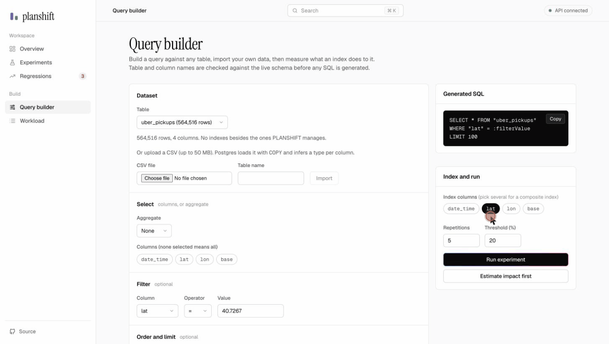
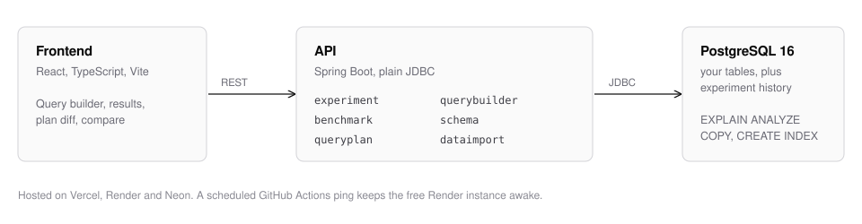

# PLANSHIFT

[](https://github.com/Vrinda072/planshift/actions/workflows/ci.yml)

Does adding that index actually help? PLANSHIFT measures it.



*564,516 Uber pickups loaded from a CSV. Indexing `lat` takes the filtered
query from 10.0 ms to 0.28 ms, and the plan shows why.*

**Live:** [frontend](https://frontend-mauve-two-60.vercel.app) ·
[backend health](https://planshift-backend.onrender.com/api/health). It's
on free hosting, so the first request after a quiet spell can take ~30 s.

## What it does

Pick a table and a query, then choose an index (one column or several).
PLANSHIFT times the query without the index, creates it, times it again, and
compares the execution plans Postgres used both times. You get faster,
slower or no real difference, and the scan strategy that changed. It works on
a built-in 10-query workload or on any table, including your own CSV.

## Example

The Uber pickups data ([fivethirtyeight](https://github.com/fivethirtyeight/uber-tlc-foil-response),
April 2014) has `date_time`, `lat`, `lon` and `base`. The query filters on
one `lat` value, tested with two different indexes (median of 7 runs):

| Index | Before | After | Change | Plan |
|---|---:|---:|---:|---|
| `lat` | 7.12 ms | 0.51 ms | -92.9% | Seq Scan to Bitmap Index Scan |
| `(base, lat)` | 9.52 ms | 7.19 ms | -24.5% | unchanged, so the drop is noise |

Same column, very different result: a composite index is ordered, so
`(base, lat)` only helps filters that start with `base`. On the built-in
e-commerce data (500k orders), the order-history query improves 97% with an
index on `orders.customer_id` (8.6 ms to 0.26 ms), while queries that don't
filter on that column stay within noise.

## How it works

- Each query runs N times per side and the **median** is used, since one
  timing is mostly noise. The change is `(after - before) / before`; beyond
  a threshold (20% by default) it counts as improved or regressed.
- Each side gets an untimed warm-up first. Without it, whichever side runs
  second inherits a warm cache and looks faster whatever the index does.
- Before the baseline, every index PLANSHIFT created earlier on that table is
  dropped, so "before" really means "none of ours". Indexes you made yourself
  are never touched.
- Plans come from `EXPLAIN (ANALYZE, BUFFERS, FORMAT JSON)`, are parsed into a
  small tree and diffed, which is where "Seq Scan to Bitmap Index Scan" comes from.
- No raw SQL is accepted. Table and column names are checked against
  `information_schema`, and the one user value (a filter value) is a bound
  parameter.
- Experiments run on a background thread. The UI polls and shows the phase it
  is actually in.
- "Estimate impact first" gives a quick guess from a plain `EXPLAIN` plus past
  runs, and says so when it has too little history to be more than a rule of
  thumb.

## Architecture



No queue, no ORM, no microservices. The backend packages are `experiment`,
`benchmark`, `queryplan`, `querybuilder`, `schema`, `dataimport`, `datagen`
and `workload`, under `backend/src/main/java/com/planshift/`.

## Running it

Needs Docker.

```bash
git clone https://github.com/Vrinda072/planshift.git
cd planshift
cp .env.example .env
docker compose up -d --build
```

The UI is on :5173, the API on :8080, Postgres on :5432. If any of those
ports are taken, remap them with `POSTGRES_HOST_PORT`, `BACKEND_HOST_PORT`
and `FRONTEND_HOST_PORT` in `.env` and rebuild (the frontend bakes in the
API URL at build time).

The database starts empty. Load the built-in dataset (100k customers, 500k
orders) with:

```bash
cd backend
mvn spring-boot:run -Dspring-boot.run.arguments="--generate-data --scale=full"
```

or skip it and import your own CSV from the query builder. For development
without rebuilding images:

```bash
docker compose up -d postgres
cd backend && mvn spring-boot:run          # :8080
cd frontend && npm install && npm run dev  # :5173
```

## Tests

```bash
cd backend && mvn verify   # 44 tests; integration tests use Testcontainers, so Docker must be running
cd frontend && npm test    # 18 tests
```

The integration tests run against a real Postgres: the full experiment
pipeline, CSV import through `COPY`, already-indexed column detection and
composite index creation. One test used to assert `candidate <= baseline`,
which flaked on sub-millisecond timing noise, so it now asserts that the scan
strategy changed instead.

## API

| Endpoint | Description |
|---|---|
| `GET /api/health` | App and DB connectivity check |
| `GET /api/queries` | The 10-query workload catalog |
| `GET /api/experiments` | All past experiments, summary |
| `GET /api/experiments/{id}` | Full detail incl. plan JSON; poll while `RUNNING` for live phase |
| `POST /api/experiments` | Starts a baseline-vs-candidate experiment (202, async) |
| `GET /api/regressions` | Every regressed query result, across experiments |
| `GET /api/schema/tables` | Table/column introspection for the query builder |
| `POST /api/query-builder/preview` | Validates a query spec and returns the generated SQL |
| `POST /api/query-builder/run` | Runs an experiment against a custom table/query (202, async) |
| `POST /api/query-builder/predict-impact` | Estimates the result without running the real experiment |
| `POST /api/datasets/import` | Multipart CSV upload → new Postgres table via `COPY` |

## Stack

Java 21, Spring Boot 3.5, Maven, PostgreSQL 16, JDBC, JUnit 5,
Testcontainers, React, TypeScript, Vite, Docker Compose.
