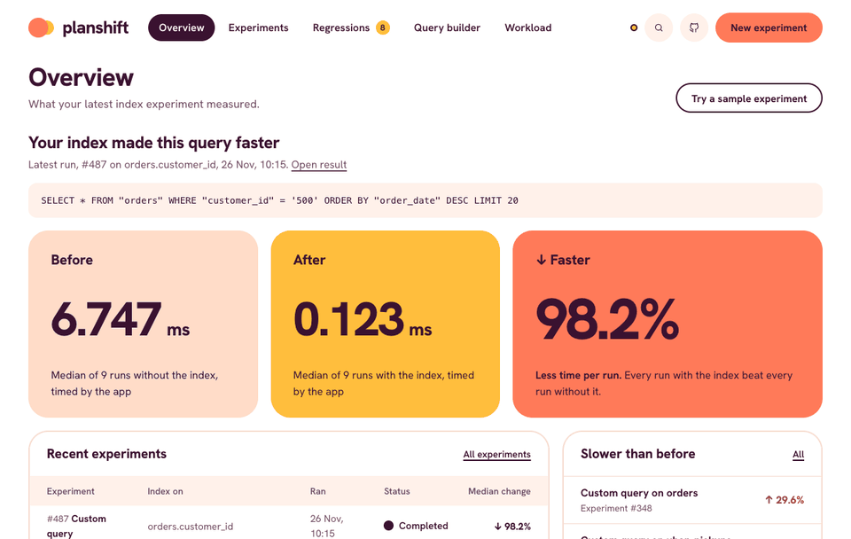

# PLANSHIFT

[](https://github.com/Vrinda072/planshift/actions/workflows/ci.yml)

Does adding that index actually help? PLANSHIFT measures it.



*The sample experiment: one query against four candidate indexes, then the
runs and plans behind the best one.*

**Live:** [frontend](https://frontend-mauve-two-60.vercel.app) ·
[backend health](https://planshift-backend.onrender.com/api/health). It's
on free hosting, so the first request after a quiet spell can take ~30 s.
**Try a sample experiment** on the Overview page runs one query against four
indexes and shows what each saves and costs.

## What has been measured

- **Run order matters a lot** ([noise checks](#how-noisy-are-the-timings)):
  where nothing should change, taking turns with and without the index reported
  a change in 0 of 120 comparisons. Measuring in blocks reported 10 of 120.
- **Joins and multi-column filters** ([study](docs/hard-study.md), 272
  measurements): ranking candidates with Postgres's own planner (HypoPG)
  found a near-best index with its first pick on all 22 queries. A
  hand-written column rule did no better than random on two picks, because of
  joins. The data is mostly generated, which flatters the planner.
- **The planner can still be badly wrong:** on the single-filter study, 7 of the
  53 indexes it expected to halve a query's cost saved under 20% of the time,
  and some made it slower. Estimates are there to choose what to measure.
- **Single-filter queries** ([study](docs/index-study.md), 224 experiments):
  trying the filter column, then the filter column plus the other column,
  recovered 99% of the best saving. Two random picks already got 90%, and a
  learned ranker wasn't worth it.
- **Tests:** 69 backend (38 unit, 31 against a real Postgres), 27 frontend and
  one full-stack browser test, all run in CI.

## What it does

Pick a table and a query, then choose an index (one column or several).
PLANSHIFT times the query without the index, creates it, times it again,
removes it, and compares the execution plans Postgres used both times. You get faster,
slower or no real difference, and the scan strategy that changed. It works on
a built-in 10-query workload or on any table, including your own CSV. From the
query builder you can also measure several candidate indexes for one query side
by side, with each one's size and build time.

## Example

The numbers here were measured with the "in blocks" order. The Uber pickups data ([fivethirtyeight](https://github.com/fivethirtyeight/uber-tlc-foil-response),
April 2014) has `date_time`, `lat`, `lon` and `base`. The query filters on
one `lat` value, tested with two different indexes, three times each (15 runs
per side):

| Index | Change in median, three tries | Plan |
|---|---|---|
| `lat` | -93.5%, -95.5%, -96.0% | Seq Scan to Bitmap Index Scan |
| `(base, lat)` | -0.1%, -3.9%, -17.9% | no change |

Same column, very different result: a composite index is ordered, so
`(base, lat)` is of little use to a filter that doesn't start with `base`. Its
plan never changes, so none of those differences come from the index. On the
built-in e-commerce data (500k orders), the order-history query improves 97%
with an index on `orders.customer_id` (8.6 ms to 0.26 ms).

## How noisy are the timings?

Two kinds of comparison where any difference is noise: **A/A** runs of the
built-in workload with no change at all, and queries given an **unused index**,
so the plan is identical on both sides. Each was run in both orders, shuffled
together (10 runs per side, 500k orders, Postgres 16 in Docker on a laptop):

| 60 comparisons per row | Moved more than 20% | Reported as a change | 9 in 10 moved less than |
|---|---:|---:|---:|
| A/A, in blocks | 10 | 9 | 30.5% |
| A/A, taking turns | 2 | 0 | 8.2% |
| Unused index, in blocks | 5 | 1 | 19.7% |
| Unused index, taking turns | 0 | 0 | 4.6% |

So **taking turns is the default**. It builds the index once, and for each run
without it drops the index inside a transaction that is then rolled back, so
nothing is rebuilt. It also does an untimed run before every timed one; this
test doesn't separate which of the two helps. The price is more executions, and
other readers of the table wait during each run without the index. "In blocks"
is still available where that matters.

None of this makes the rank-sum test exact. It assumes independent runs, and
earlier A/A batches in block order showed runs speeding up and slowing down
together: 11 to 17 of 100 comparisons moved more than 20%. A zero here is zero
out of 60 on one laptop, not a zero error rate. Check your own setup with the
**A/A check** button or `python3 bench/mode_check.py`. Raw numbers are in
`bench/results/`.

## How it works

- Each query runs N times per side and the **median** is used. The change is
  `(after - before) / before`. It counts as improved or regressed only if it
  passes a threshold (20% by default) and, with 4 or more runs, a Mann-Whitney
  rank-sum test can tell the two sets of timings apart. Every timing is kept
  and shown.
- The two sides take turns, swapping which goes first each round. In the "in
  blocks" order, half the "before" runs happen ahead of the "after" runs and
  half behind them, so steady drift doesn't favour either side.
- Timings are measured by the app, so they include the driver and reading the
  rows. Postgres's own execution time and buffer hits and reads come from a
  separate `EXPLAIN ANALYZE` run and are shown separately.
- The live demo times runs with Postgres's own clock instead
  (`TIMING_SOURCE=database`). On the free host, app-side timings jumped by about
  90 ms at random, probably from CPU throttling, while Postgres reported a
  steady 2.5 ms for the same query; one candidate even showed +1560%. The
  rank-sum test refused to count it, but those timings weren't usable. Each
  result says which clock produced it.
- Each side is warmed up untimed first. Without that, whichever runs second
  inherits a warm cache and looks faster whatever the index does.
- Experiments run one at a time, from a queue of up to 10. A Postgres advisory
  lock extends that across API instances, such as the old and new one during a
  deploy, and also holds off CSV imports and data generation, which would
  replace tables mid-measurement. An instance only gives up on another's
  experiments when it can prove they are abandoned: the lock is free, or their
  heartbeats have stopped.
- Each run creates its own temporary index, records that it owns it in the same
  transaction, and removes exactly that one afterwards, whether it succeeds,
  fails or is cut off by a restart. Indexes that already existed stay in place
  for both sides.
- Each result gives the `CREATE INDEX` statement to copy. With
  `ALLOW_KEEP_INDEX=true`, a button also creates that index (and removes it
  again). It is off by default and on the live demo: there is no sign-in, so
  anyone could change the database everyone measures against.
- Plans come from `EXPLAIN (ANALYZE, BUFFERS, FORMAT JSON)`, are parsed into a
  small tree and diffed, which is where "Seq Scan to Bitmap Index Scan" comes from.
- No raw SQL is accepted. Table and column names are checked against
  `information_schema`, and the one user value (a filter value) is a bound
  parameter.
- The UI polls and shows whether a run is queued or which phase it is actually in.
- "Estimate impact first" builds nothing and runs only plain `EXPLAIN`s. Where
  the [HypoPG](https://github.com/HypoPG/hypopg) extension is available (it is
  in the Docker setup here), it asks Postgres's planner what the query would
  cost if the index existed, and clears the hypothetical index straight away.
  Read as a change in time, that was off by a median of 6 percentage points on
  the [first study's](docs/index-study.md) pairs, with the exceptions above.
  Without HypoPG it takes the median of past runs that used an index the same
  way on a similarly selective filter (off by 11, with generous history), or
  with fewer than three of those, a rule of thumb marked low confidence (43).

## Architecture


No message broker, no ORM, no microservices. The backend packages are `experiment`,
`benchmark`, `queryplan`, `querybuilder`, `schema`, `dataimport`, `datagen`,
`workload` and `lock`, under `backend/src/main/java/com/planshift/`.

## Running it

Needs Docker.

```bash
git clone https://github.com/Vrinda072/planshift.git
cd planshift
cp .env.example .env
docker compose up -d --build
```

The UI is on :5173, the API on :8080, Postgres on :5432. If any of those
ports are taken, remap them with `POSTGRES_HOST_PORT`, `BACKEND_HOST_PORT`
and `FRONTEND_HOST_PORT` in `.env` and rebuild (the frontend bakes in the
API URL at build time).

The database starts empty. Load the built-in dataset (100k customers, 500k
orders) with:

```bash
cd backend
mvn spring-boot:run -Dspring-boot.run.arguments="--generate-data --scale=full --server.port=0"
```

(`--server.port=0` avoids clashing with the API already running in Docker.
Stop it with Ctrl+C once it logs that generation has finished.)

or skip it and import your own CSV from the query builder. For development
without rebuilding images:

```bash
docker compose up -d postgres
cd backend && mvn spring-boot:run          # :8080
cd frontend && npm install && npm run dev  # :5173
```

## Tests

```bash
cd backend && mvn verify   # integration tests use Testcontainers, so Docker must be running
cd frontend && npm test
cd frontend && npm run e2e # needs the stack up; uses your installed Chrome
```

The integration tests run against a real Postgres. They cover the experiment
pipeline, CSV import, filtering on different column types, kept indexes, and
isolation: two experiments can't overlap, another instance's run is left alone,
a failure leaves earlier indexes in place, and hiding an index doesn't stop
Postgres planning in parallel. The browser test imports a CSV, runs an
experiment and checks that both plans show up. No test asserts on timing, which
is too noisy to pass reliably.

## API

| Endpoint | Description |
|---|---|
| `GET /api/health` | App and DB connectivity check |
| `GET /api/queries` | The 10-query workload catalog |
| `GET /api/experiments` | All past experiments, summary |
| `GET /api/experiments/{id}` | Full detail incl. plan JSON; poll while `RUNNING` for live phase |
| `POST /api/experiments` | Starts a baseline-vs-candidate experiment (202, async) |
| `POST` / `DELETE /api/experiments/{id}/kept-index` | Creates or removes a lasting copy of the tested index (403 unless enabled) |
| `GET /api/config` | Whether keeping indexes is enabled |
| `GET /api/regressions` | Every regressed query result, across experiments |
| `GET /api/schema/tables` | Table/column introspection for the query builder |
| `POST /api/query-builder/preview` | Validates a query spec and returns the generated SQL |
| `POST /api/query-builder/run` | Runs an experiment against a custom table/query (202, async) |
| `POST /api/query-builder/predict-impact` | Estimates the result without running the real experiment |
| `POST /api/datasets/import` | Multipart CSV upload → new Postgres table via `COPY` |

## Stack

Java 21, Spring Boot 3.5, Maven, PostgreSQL 16 (with HypoPG), JDBC, JUnit 5,
Testcontainers, React, TypeScript, Vite, Docker Compose.
