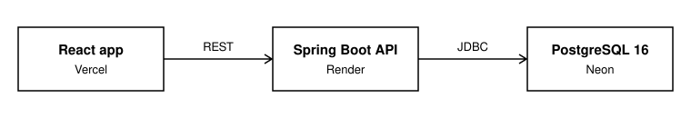

# PLANSHIFT

[](https://github.com/Vrinda072/planshift/actions/workflows/ci.yml)

Does adding that index actually help? PLANSHIFT measures it.


*564,516 Uber pickups loaded from a CSV. Indexing `lat` takes the filtered
query from 10.0 ms to 0.28 ms, and the plan shows why.*

**Live:** [frontend](https://frontend-mauve-two-60.vercel.app) ·
[backend health](https://planshift-backend.onrender.com/api/health). It's
on free hosting, so the first request after a quiet spell can take ~30 s.
**Try a sample experiment** on the Overview page runs one query against four
indexes and shows what each saves and costs.

## What has been measured

- **Which indexes to try** ([study](docs/index-study.md), 224 experiments):
  trying just the filter column, then the filter column plus the query's other
  column, recovered 99% of the best saving found by testing every candidate.
  Two random picks already got 90%, so on single-filter queries this is an
  easy choice, and a learned ranker wasn't worth it.
- **How much to trust a timing** ([A/A checks](#how-noisy-are-the-timings)):
  with nothing changed, 11 to 17 of 100 comparisons still moved by more than
  20%.
- **Tests:** 58 backend (38 unit, 20 against a real Postgres), 25 frontend and
  one full-stack browser test, all run in CI.

## What it does

Pick a table and a query, then choose an index (one column or several).
PLANSHIFT times the query without the index, creates it, times it again,
removes it, and compares the execution plans Postgres used both times. You get faster,
slower or no real difference, and the scan strategy that changed. It works on
a built-in 10-query workload or on any table, including your own CSV. From the
query builder you can also measure several candidate indexes for one query side
by side, with each one's size and build time.

## Example

The Uber pickups data ([fivethirtyeight](https://github.com/fivethirtyeight/uber-tlc-foil-response),
April 2014) has `date_time`, `lat`, `lon` and `base`. The query filters on
one `lat` value, tested with two different indexes, three times each (15 runs
per side):

| Index | Change in median, three tries | Plan |
|---|---|---|
| `lat` | -93.5%, -95.5%, -96.0% | Seq Scan to Bitmap Index Scan |
| `(base, lat)` | -0.1%, -3.9%, -17.9% | no change |

Same column, very different result: a composite index is ordered, so
`(base, lat)` is of little use to a filter that doesn't start with `base`. Its
plan never changes, so none of those differences come from the index. On the
built-in e-commerce data (500k orders), the order-history query improves 97%
with an index on `orders.customer_id` (8.6 ms to 0.26 ms).

## How noisy are the timings?

An A/A check runs the whole procedure with nothing changed, so every
difference it finds is noise. Two batches of 10 checks on the built-in
workload (10 queries, 10 runs per side, 500k orders, Postgres 16 in Docker on
a laptop):

| Nothing changed, 100 comparisons each | Right after a restart | Warmed up |
|---|---:|---:|
| Median moved more than 20% | 11 | 17 |
| Still reported after the rank-sum test | 4 | 12 |
| Test said the two sides differ (p < 0.05) | 17 | 32 |

The test removes some false alarms, not all of them. If runs were independent
it would call about 5 in 100 different; it called 17 and 32, because whole
batches of runs speed up or slow down together. So on a setup like this, treat
a change of 20 to 30% as unproven even when the runs look separated. A plan
change with a large speedup is far stronger evidence. Run the A/A check on
your own setup before trusting small differences: it's a button in the UI, or
`python3 bench/aa_check.py`. The raw numbers are in `bench/results/`.

## How it works

- Each query runs N times per side and the **median** is used. The change is
  `(after - before) / before`. It counts as improved or regressed only if it
  passes a threshold (20% by default) and, with 4 or more runs, a Mann-Whitney
  rank-sum test can tell the two sets of timings apart. Every timing is kept
  and shown.
- Half the "before" runs happen ahead of the "after" runs and half behind
  them, so a machine that is steadily speeding up or slowing down doesn't
  favour either side.
- Timings are measured by the app, so they include the driver and reading the
  rows. Postgres's own execution time and buffer hits and reads come from a
  separate `EXPLAIN ANALYZE` run and are shown separately.
- The live demo times runs with Postgres's own clock instead
  (`TIMING_SOURCE=database`). On the free host, app-side timings jumped by about
  90 ms at random, probably from CPU throttling, while Postgres reported a
  steady 2.5 ms for the same query; one candidate even showed +1560%. The
  rank-sum test refused to count it, but those timings weren't usable. Each
  result says which clock produced it.
- Each side gets an untimed warm-up first. Without it, whichever side runs
  second inherits a warm cache and looks faster whatever the index does.
- Experiments run one at a time, from a queue of up to 10, so none is measured
  while another is changing indexes. This covers a single API instance, which
  is how it's deployed.
- Each run creates its own temporary index, records that it owns it in the same
  transaction, and removes exactly that one afterwards, whether it succeeds,
  fails or is cut off by a restart. Indexes that already existed stay in place
  for both sides.
- Plans come from `EXPLAIN (ANALYZE, BUFFERS, FORMAT JSON)`, are parsed into a
  small tree and diffed, which is where "Seq Scan to Bitmap Index Scan" comes from.
- No raw SQL is accepted. Table and column names are checked against
  `information_schema`, and the one user value (a filter value) is a bound
  parameter.
- The UI polls and shows whether a run is queued or which phase it is actually in.
- "Estimate impact first" runs only plain `EXPLAIN`s. It looks at the whole
  index (one whose first column the query can't use is expected to do
  nothing), then takes the median of past runs that used an index the same way
  on a similarly selective filter. With fewer than three of those it gives a
  rule of thumb and marks it low confidence.

## Architecture



No queue, no ORM, no microservices. The backend packages are `experiment`,
`benchmark`, `queryplan`, `querybuilder`, `schema`, `dataimport`, `datagen`
and `workload`, under `backend/src/main/java/com/planshift/`.

## Running it

Needs Docker.

```bash
git clone https://github.com/Vrinda072/planshift.git
cd planshift
cp .env.example .env
docker compose up -d --build
```

The UI is on :5173, the API on :8080, Postgres on :5432. If any of those
ports are taken, remap them with `POSTGRES_HOST_PORT`, `BACKEND_HOST_PORT`
and `FRONTEND_HOST_PORT` in `.env` and rebuild (the frontend bakes in the
API URL at build time).

The database starts empty. Load the built-in dataset (100k customers, 500k
orders) with:

```bash
cd backend
mvn spring-boot:run -Dspring-boot.run.arguments="--generate-data --scale=full --server.port=0"
```

(`--server.port=0` avoids clashing with the API already running in Docker.
Stop it with Ctrl+C once it logs that generation has finished.)

or skip it and import your own CSV from the query builder. For development
without rebuilding images:

```bash
docker compose up -d postgres
cd backend && mvn spring-boot:run          # :8080
cd frontend && npm install && npm run dev  # :5173
```

## Tests

```bash
cd backend && mvn verify   # integration tests use Testcontainers, so Docker must be running
cd frontend && npm test
cd frontend && npm run e2e # needs the stack up; uses your installed Chrome
```

The integration tests run against a real Postgres. They cover the experiment
pipeline, CSV import, filtering on different column types, and isolation: two
experiments on one table can't overlap, and a failure after index creation
leaves earlier indexes alone. The browser test imports a CSV, runs an
experiment and checks that both plans show up. No test asserts on timing, which
is too noisy to pass reliably.

## API

| Endpoint | Description |
|---|---|
| `GET /api/health` | App and DB connectivity check |
| `GET /api/queries` | The 10-query workload catalog |
| `GET /api/experiments` | All past experiments, summary |
| `GET /api/experiments/{id}` | Full detail incl. plan JSON; poll while `RUNNING` for live phase |
| `POST /api/experiments` | Starts a baseline-vs-candidate experiment (202, async) |
| `GET /api/regressions` | Every regressed query result, across experiments |
| `GET /api/schema/tables` | Table/column introspection for the query builder |
| `POST /api/query-builder/preview` | Validates a query spec and returns the generated SQL |
| `POST /api/query-builder/run` | Runs an experiment against a custom table/query (202, async) |
| `POST /api/query-builder/predict-impact` | Estimates the result without running the real experiment |
| `POST /api/datasets/import` | Multipart CSV upload → new Postgres table via `COPY` |

## Stack

Java 21, Spring Boot 3.5, Maven, PostgreSQL 16, JDBC, JUnit 5,
Testcontainers, React, TypeScript, Vite, Docker Compose.
